

    
  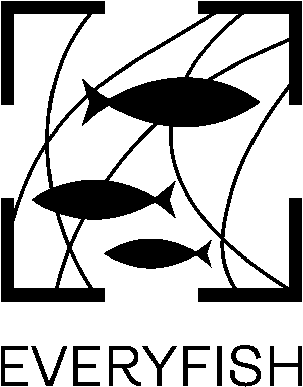
  &nbsp;&nbsp;&nbsp;&nbsp;
  

&nbsp;

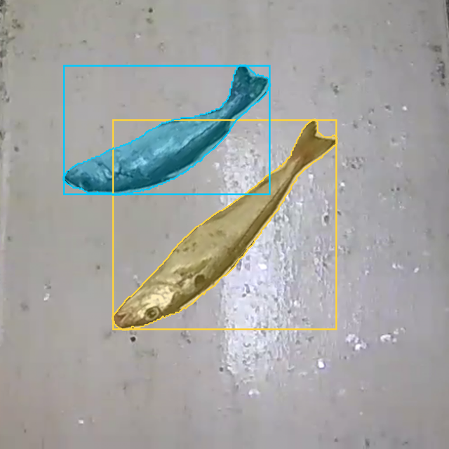 
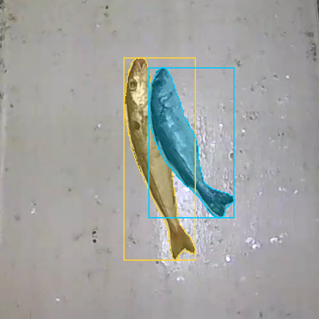 
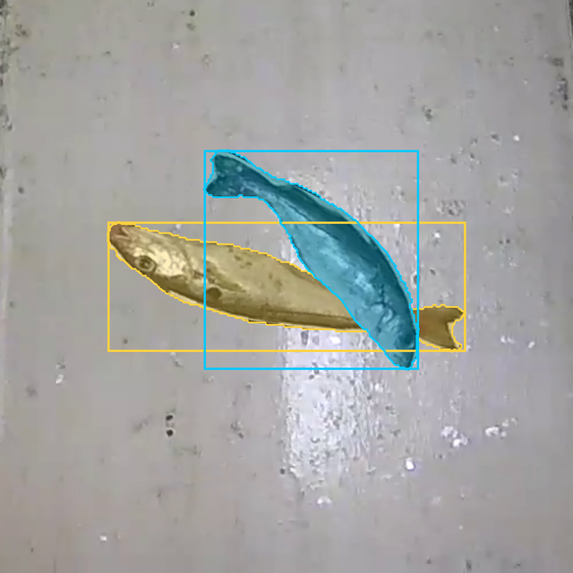 
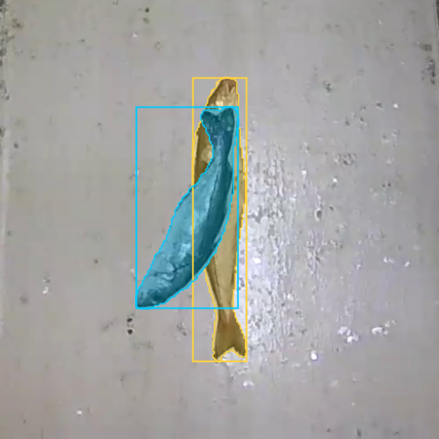 
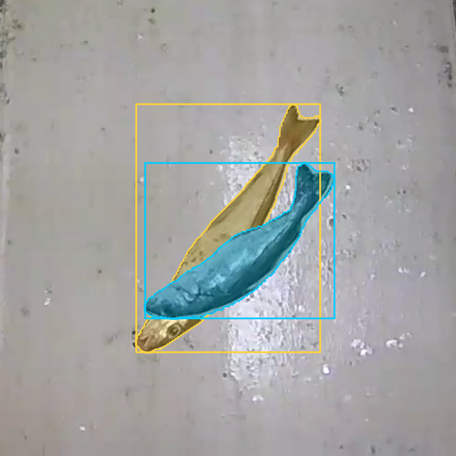 
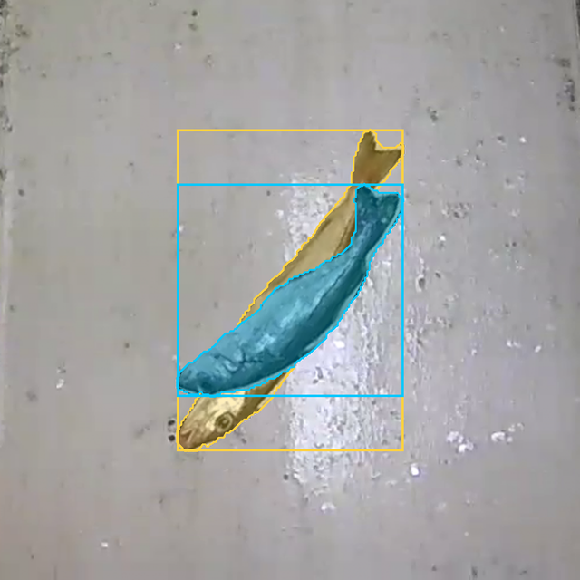 

&nbsp;

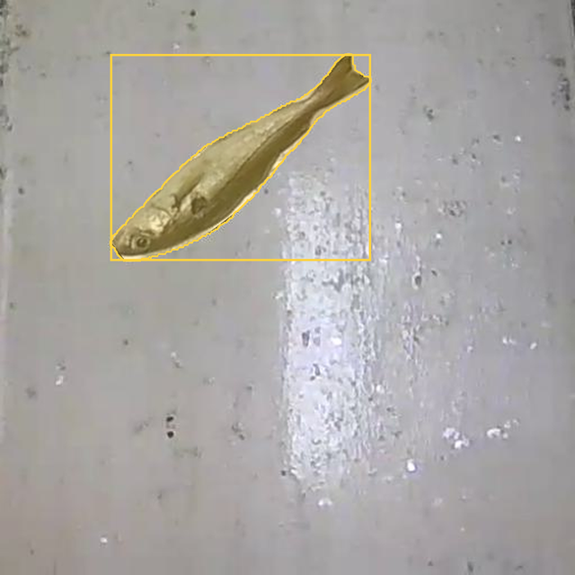 
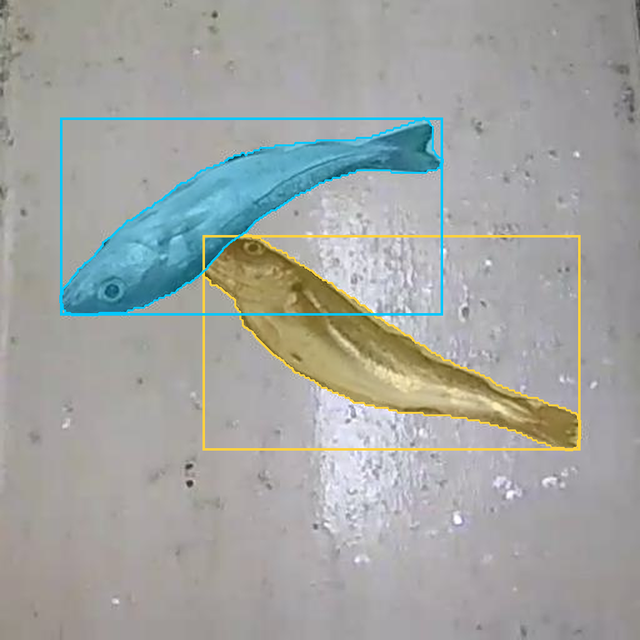 
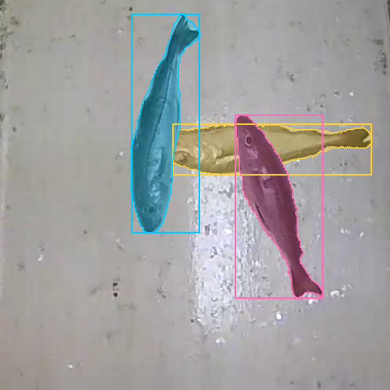 
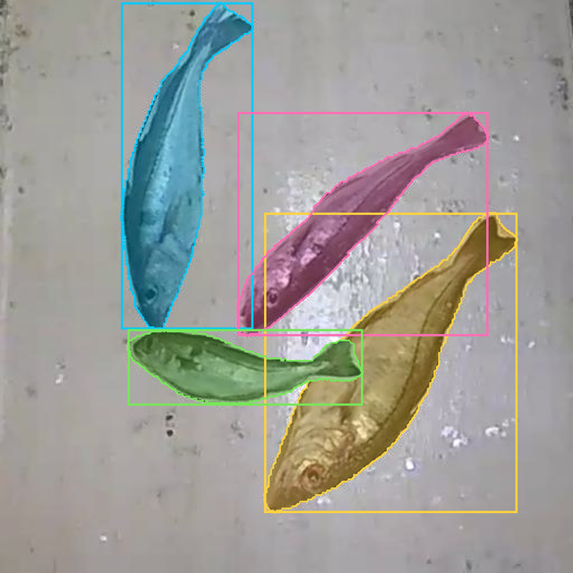 
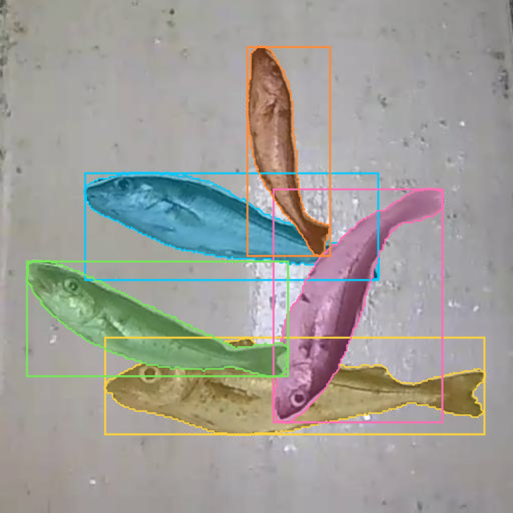 
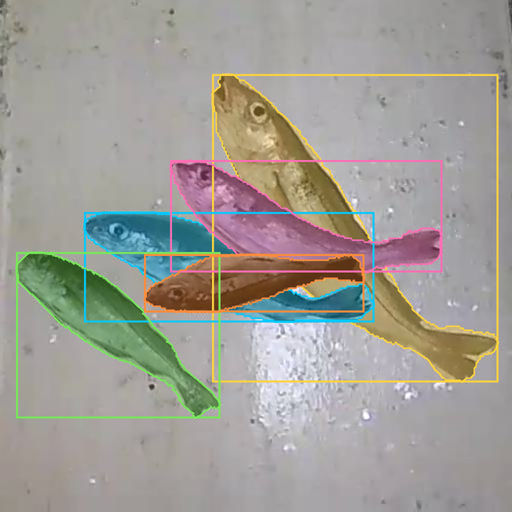 

# Project Title
EVERYFISH SYNTHETIC-DATASET-GENERATOR (COMPOSITOR)
## Description
A Python library for generating 'synthetic' (composited) imagery for training and testing AI models targeting fisheries REM video surveilance applications. 

## Table of Contents
- [Installation](#installation)
- [Usage](#usage)
- [Documentation](#documentation)
- [Contributing](#contributing)
- [License](#license)
- [Acknowlegement](#ackknowledgement)

## Installation
1. Clone the repository:
  git clone https://<username>@git.imr.no/everyfish/synthetic-dataset-generator 
2. Install syndatagen package:  
$ cd synthetic-dataset-generator  
$ pip install -v -e .  
'-v' means verbose, or more output,  
'-e' means installing a project in editable mode,  
thus any local modifications made to the code will take effect without reinstallation.
3. Dependencies  
You do not need a GPU. See requirements.txt for details of the development environment. 
4. Download the single whole fish database:  
<a href="https://zenodo.org/records/23238609" download>Download ZIP</a>   
5. Create a symbolic link to the database: ./data -> single_whole_fish  
Note: If ./data is not linked you will need to edit the \[DEFAULT] section of "./configs/config.ini"  
6. Run the demo
$ python ./demo/demo.py

## Useage
Composited images are composed of individual fish placed on a background canvas, together with associated .json annotations. There are two placement modes:  
1. Random.  
2. IoU specific. Note: This mode only supports TWO fish per image.  

A selection of example images are shown above. In mode 2, the placement of individual fish in the composited image is parameterised. This allows training/validation/test datasets to be generated with a specific intersection-over-union (IoU) relationship.  These are useful for exploring the robustness of AI models with regard to occlusion. 

The file `inventory.csv` stores details of all fish in the database. To ensure individuals are unique in training, validation and test datasets, the inventory is split into `train.csv`, `val.csv` and `test.csv`, and `demo.py` creates train, val, test datasets by selecting fish from the associated `train/val/test.csv`.    

## Documentation
- [learn about config](docs/customize_config.md)
- [learn about database](docs/database.md)
- [learn about demo](docs/demo.md)
- [useful tools](docs/useful_tools.md)  

## Contributing
Contributers are welcome to clone/modify/share the package subject to the terms of the License. 

## License
This project is released under the [GNU General Puplic License V3.0](https://www.gnu.org/licenses/gpl-3.0.en.html) 

## Acknowledgement
[EVERYFISH](https://everyfish.eu/) acknowledge funding from the European Unions Horizon Europe research and innovation programme under grant agreement number 101059892.  
Contributers:  
Dr. Geoff French <brittix1023@gmail.com>  
Dr. Ruth Veevers  
Dr. Mark Fisher <Mark.Fisher@uea.ac.uk>  
Dr. Hang Zhou <Hang.Zhou@uea.ac.uk>  
Prof. Michal Mackiewicz <M.Mackiewicz@uea.ac.uk>

## Contact
<Mark.Fisher@uea.ac.uk>
