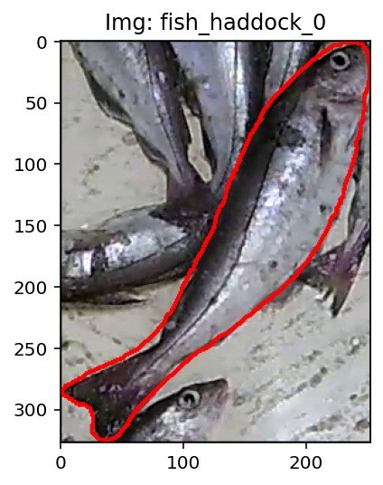
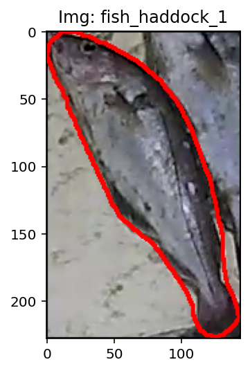
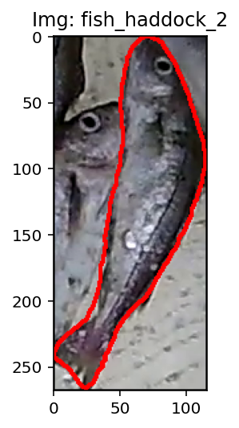
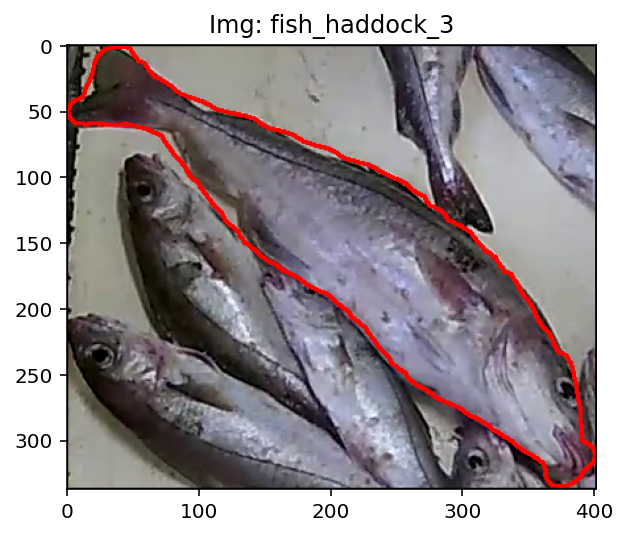
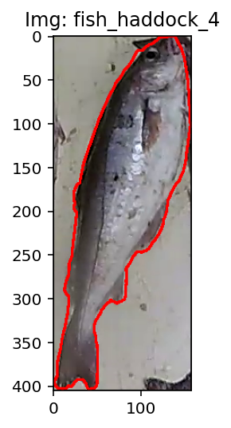
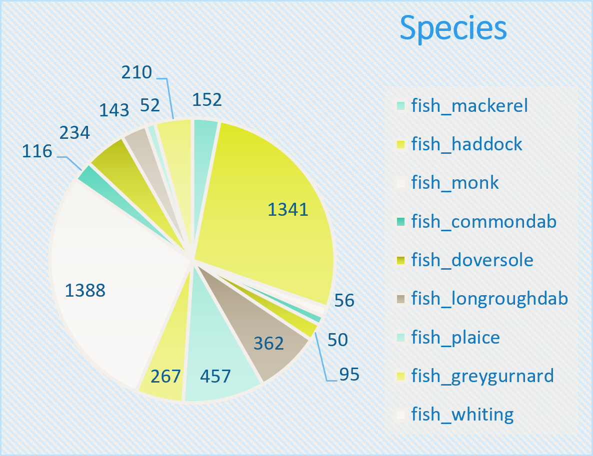
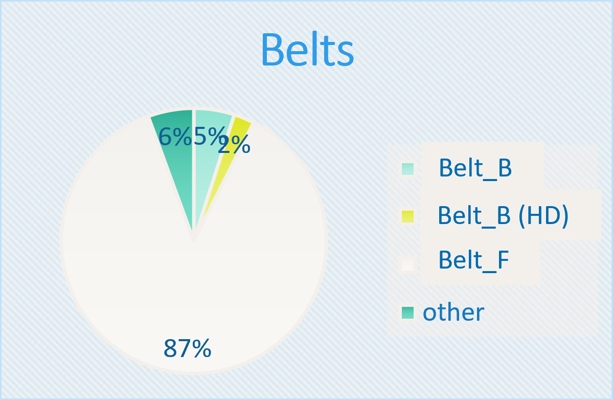

 
 
 
 
 

&nbsp;

Images are formed by compositing individuals from an annotated database of single whole fish (examples shown above). 
The database comprises approx. 4000 individuals that have been collected during projects involving [Marine Scotland](https://masts.ac.uk/resource/marine-laboratory/), [CEFAS](https://www.cefas.co.uk/), and [UEA](https://my.uea.ac.uk/), funded by the Scottish Government and the European Union.

&nbsp;

&nbsp;

The database represents fish species, collected from conveyor belts aboard 7 vessels (see above).

&nbsp;

We will publish the full database once we have permission from all partners. In the meantime we provide a small sample database of 100 individials, sufficient to run "./demo/demo.py"  
<a href="https://www.dropbox.com/scl/fi/ztd86xj3k8xdw00btku8y/single_whole_fish_sample.zip?rlkey=ti5wl3xgrctr3snfjqf48ri5p&st=zn84mssc&dl=0" download>Download ZIP</a>   
